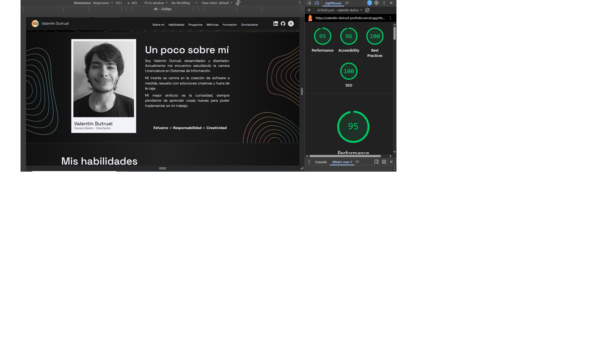

# Portfolio Web Personal — Valentín Abel Dutruel

> **Trabajo Final Integrador — Diseño UX/UI (2026)**  
> **Carrera:** Licenciatura en Sistemas de Información — **Facultad:** FCyT sede CdelU (UADER)  
> **Docente:** Prof. Ernesto Ledesma  
> **Sitio Web:** [valentin-dutruel-portfolio.vercel.app](https://valentin-dutruel-portfolio.vercel.app/)  
> **Repositorio:** [github.com/Pendorchoide/Portfolio-Web](https://github.com/Pendorchoide/Portfolio-Web)  

---

## Enlaces y Entregables

- **URL de Producción:** [https://valentin-dutruel-portfolio.vercel.app/](https://valentin-dutruel-portfolio.vercel.app/)
- **Prototipo de Diseño:** Realizado en **Adobe Illustrator** para lograr un control milimétrico sobre las curvas vectoriales fluidas y los granulados multicolor (se adjunta archivo `.ai` y PDF de visualización del prototipo en Classroom).
- **Despliegue:** Alojado en **Vercel** con CI/CD automático en cada push a la rama `main`.

---

## Proceso UX/UI y Concepto

- **Enfoque y Usuario Objetivo:** Orientado a potenciales empleadores y reclutadores en búsqueda de perfiles de diseño y desarrollo creativo; por ello se hace fuerte hincapié en herramientas de diseño gráfico, 2D y 3D además de desarrollo en la sección de habilidades.
- **Concepto Visual:** Estilo descontracturado y fluido reflejado en curvas vectoriales orgánicas a lo largo de la página, complementadas por texturas analógicas de grano y una paleta con acentos en gradiente cálido-frío.
- **Referencias (Benchmark):**
  - [Juan Joaquín Garín]([https://www.jgarin.com/])
  - [Estudio Flashbacks]([https://estudioflashbacks.com.ar/])
  - [Benjamín Delgado]([https://benjamindelgado.vercel.app/])

---

## Testing y Validación con Usuarios

Se realizaron entrevistas y pruebas de usabilidad con 3 usuarios sobre 3 tareas:
1. Análisis de contraste y legibilidad general de textos.
2. Búsqueda del enlace hacia GitHub.
3. Localización de la trayectoria académica.

### Testimonios y Hallazgos
- **Lucía (21 años):** Texto legible en general. Ubicó GitHub de inmediato en la sección de contacto. Tuvo dificultades para percibir que la timeline académica contenía botones interactivos.
- **Benjamín (26 años):** Notó textos algo pequeños en ciertas secciones. Ubicó GitHub rápidamente en la barra de navegación y encontró la información académica con facilidad.
- **Beatriz (55 años):** Presentó dificultad con el tamaño de los textos más reducidos. Ubicó GitHub en contacto y dudó sobre la interactividad de la timeline.

### Mejoras Implementadas
- **Indicador activo en Timeline:** Se añadió resaltado de color visible en el botón seleccionado para evidenciar interactividad.
- **Jerarquía y Escala Tipográfica:** Se aumentaron los tamaños de fuente de las etiquetas y textos secundarios para garantizar lectura cómoda sin esfuerzo visual.

---

## Stack Tecnológico y Arquitectura

- **HTML5 Semántico:** Estructura basada en 9 secciones obligatorias (`header`, `hero`, `about`, `skills`, `projects`, `metrics`, `experience`, `contact`, `footer`), con navegación por anclas y un solo `h1`.
- **CSS3 Puro (Mobile-First):**
  - Sistema de **Design Tokens** mediante variables CSS en `:root` y `[data-theme="light"]`.
  - Layout con Flexbox y CSS Grid; sin librerías ni frameworks pesados.
  - Breakpoints probados en mobile (375px), tablet (768px) y desktop (1280px+), sin scroll horizontal.
- **JavaScript Vanilla:**
  - `scripts/education.js`: Manejo dinámico y accesible de la timeline académica con `aria-live`.
  - `scripts/theme.js`: Alternancia entre modo claro y oscuro, detección de `prefers-color-scheme`, persistencia en `localStorage` y adaptación de filtros e iconos SVG.
- **Accesibilidad (WCAG 2.2 AA):**
  - Contraste validado en ambos modos.
  - Navegación 100% por teclado con foco visible (`:focus-visible`).
  - Atributos `aria-expanded` y `aria-controls` en el menú mobile.
  - Enlace accesible de salto al contenido (`.skip-link`).

---

## Métricas Lighthouse (Mobile)

Auditoría realizada sobre la versión desplegada en producción:

| Métrica | Puntaje | Estado |
| :--- | :---: | :---: |
| **Performance** | **95** | 🟢 Excelente |
| **Accessibility** | **96** | 🟢 Excelente (WCAG AA) |
| **Best Practices** | **100** | 🟢 Óptimo |
| **SEO** | **100** | 🟢 Óptimo |

*Imágenes optimizadas en formato WebP con dimensiones intrínsecas (`width`/`height`) y carga diferida (`loading="lazy"`).*

---

## Declaración de Uso de Inteligencia Artificial

- **Uso asistido:** Se utilizaron agentes de IA para generar la base inicial de maquetación en HTML y CSS a partir del prototipo.
- **Ajuste y validación humana:** La totalidad del código fue adaptada, refinada y pulida manualmente para alcanzar fidelidad estética con el diseño de Illustrator, resolver casos borde responsive y garantizar los estándares de accesibilidad y performance.

---

## Capturas

### Métricas Lighthouse

### Modo Oscuro vs Modo Claro (Desktop y Mobile)
- Prototipo y capturas completas adjuntas en la entrega del proyecto (`.ai` y PDF complementario).